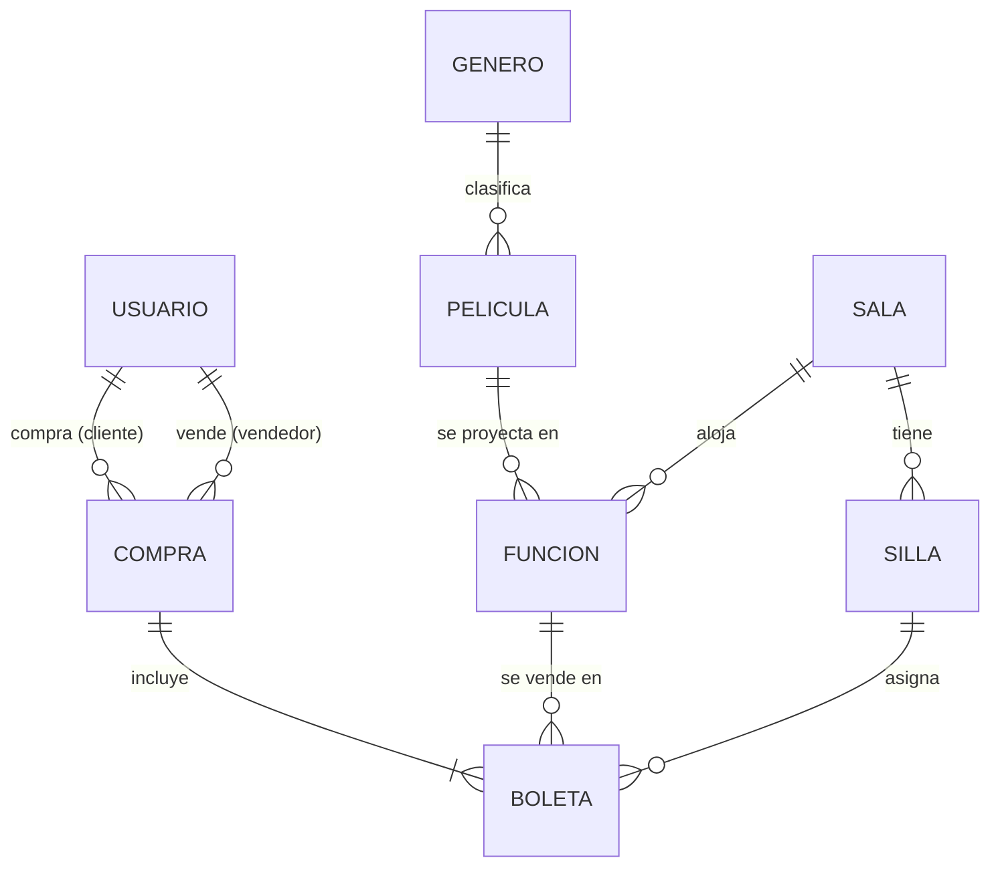

# Modelo Entidad-Relación (8 entidades JPA)

Cada entidad tiene `id` Long como PK autoincremental (`@GeneratedValue(strategy = GenerationType.IDENTITY)`) y las FK apuntan a ese id. Rol, clasificación y estados son **enums** (`@Enumerated(EnumType.STRING)`), sin tabla propia. Las mismas entidades generan el esquema en H2 y MySQL.

## Entidades

### Usuario (`usuarios`)
- `id`, `nombre_completo`, `documento`, `correo` (UNIQUE), `password_hash`, `rol`, `activo`, `fecha_registro`
- `rol`: `ADMINISTRADOR`, `TAQUILLERO`, `ACOMODADOR`, `CLIENTE`
- 1:N con Compra como **cliente** y como **vendedor**.
- Un usuario inactivo no puede iniciar sesión.

> La sal de la clave se guarda junto al hash (por ejemplo `sal:hash` en `password_hash`). Confirmar con el equipo antes de agregar una columna nueva.

### Genero (`generos`)
- `id`, `nombre` (UNIQUE), `descripcion`
- 1:N con Pelicula. No se elimina si tiene películas.

### Pelicula (`peliculas`)
- `id`, `titulo`, `sinopsis`, `duracion_min`, `clasificacion`, `poster_url`, `en_cartelera`, `id_genero` (FK)
- `clasificacion`: `TODO_PUBLICO`, `MAYOR_7`, `MAYOR_12`, `MAYOR_15`, `MAYOR_18`
- N:1 con Genero; 1:N con Funcion. `duracion_min ≥ 1`. No se elimina si tiene funciones futuras.

### Sala (`salas`)
- `id`, `nombre` (UNIQUE), `filas`, `sillas_por_fila`, `activa`
- 1:N con Silla y con Funcion. Al crearla se generan `filas × sillas_por_fila` sillas.

### Silla (`sillas`)
- `id`, `fila` (letra), `numero`, `activa`, `id_sala` (FK)
- N:1 con Sala; 1:N con Boleta. UNIQUE (`id_sala`, `fila`, `numero`).
- Una silla inactiva (fuera de servicio) no se vende.

### Funcion (`funciones`)
- `id`, `fecha_hora_inicio`, `fecha_hora_fin`, `precio`, `estado`, `id_pelicula` (FK), `id_sala` (FK)
- `estado`: `PROGRAMADA`, `CANCELADA`
- N:1 con Pelicula y con Sala; 1:N con Boleta.
- `fecha_hora_fin = inicio + duración + 15 min`. Dos funciones PROGRAMADAS de la misma sala no se cruzan.

### Compra (`compras`)
- `id`, `codigo` (UNIQUE), `fecha_compra`, `total`, `canal`, `estado`, `id_cliente` (FK, nullable), `id_vendedor` (FK, nullable)
- `canal`: `EN_LINEA`, `TAQUILLA` · `estado`: `PAGADA`, `CANCELADA`
- N:1 con Usuario; 1:N con Boleta. Entre 1 y 6 boletas. En línea exige cliente; en taquilla exige vendedor.

### Boleta (`boletas`)
- `id`, `codigo` (UNIQUE), `precio`, `estado`, `fecha_ingreso` (nullable), `id_compra` (FK), `id_funcion` (FK), `id_silla` (FK)
- `estado`: `VENDIDA`, `USADA`, `CANCELADA`
- N:1 con Compra, Funcion y Silla. Por cada (funcion, silla) existe **como máximo una boleta no CANCELADA**.

## Diagrama

## Notas de mapeo

- Precios y totales: `BigDecimal`. Fechas: `LocalDateTime` (`fecha_registro`, `fecha_compra`, `fecha_hora_inicio`, `fecha_hora_fin`, `fecha_ingreso`).
- La regla «una boleta no cancelada por (funcion, silla)» se valida en el controlador dentro de la transacción con bloqueo pesimista sobre la función, porque una UNIQUE de base de datos no puede excluir las canceladas de forma portable.
